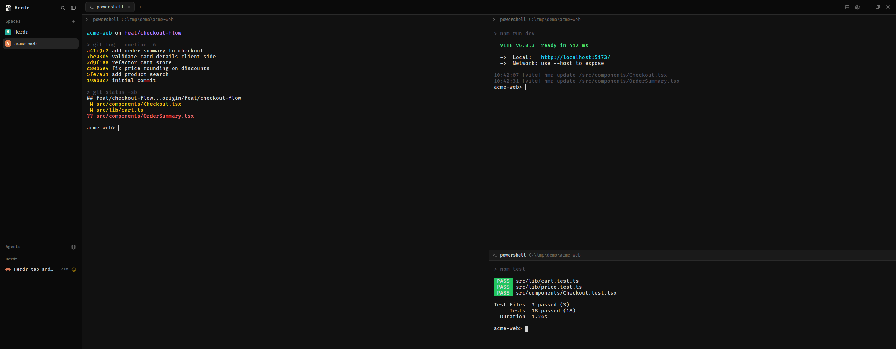

# Herdr Clean

A minimal, dark layout for [Herdr](https://herdr.dev) with a shadcn / Vercel-style palette. Panes fill the whole window, with thin dividers instead of cards, and the chrome stays out of your way.

## What's in it

- **Dark theme** (`clean-dark`): near-black sidebar and tab bar, slightly lighter panes, soft grey text instead of pure white.
- **Edge-to-edge panes**: no padding, no rounded corners, 1px dividers. The focused pane is marked by a lighter header, not an outline.
- **Collapsible sidebar**: collapse it to an icon-only rail. The logo turns into the expand button on hover, spaces show as colored tiles, and agents show their program icon with a status badge.
- **Mouse shortcuts**
  - Middle-click a **tab** to close it.
  - Middle-click a **pane header** to close that pane.
  - Middle-click a **space** to close it (asks first).
  - Left-click the **+** after the last tab for a new terminal, right-click it for the full menu.
- **Tooltips with hotkeys** on every icon button.
- **Settings and Add machine** live in the top bar next to the window buttons. The window close button turns red on hover.
- No status bar, and a bit of breathing room between the items in the spaces and agents lists.

## Install

Herdr's interface is just files, so installing is copying folders.

1. Copy the contents of this repo into your Herdr config folder:
   - Windows: `%USERPROFILE%\.config\herdr-app`
   - macOS / Linux: `~/.config/herdr-app`

   You should end up with `layouts/Clean.json`, `themes/clean-dark.json` and the five `mods/my-*` folders next to your existing files. Nothing is overwritten unless you already have files with those names.
2. Switch to it: press `Ctrl+Shift+L` to cycle layouts, or pick **Clean** in Settings.

Herdr applies changes live, so no restart is needed.

## Notes

- It builds on Herdr's own mods (`files`, `changes`, `new-menu`, `menu`, ...), so those still need to be there. They ship with Herdr.
- The `my-*` mods are copies of Herdr's `tabs`, `pane`, `spaces`, `agents` and `workspace-chrome` mods with the changes above. Herdr never updates cloned mods, so they won't pick up upstream changes.
- Made and tested on Herdr 0.1.18 (Windows). It uses only documented features, but other platforms are untested.
- Want a different look? Edit the colors in `themes/clean-dark.json`.

## Sharing

To list it on herdr.dev/layouts, add the `herdr-layout` topic to the repo.
